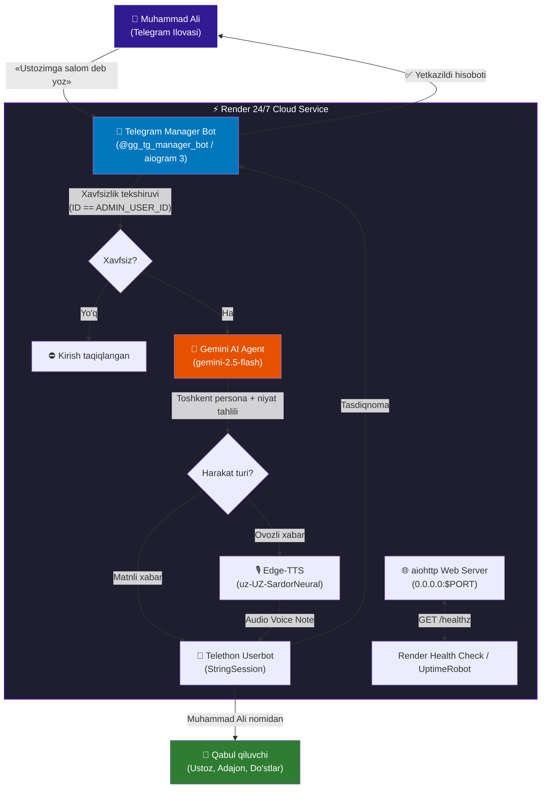

# 🤖 Telegram Manager — AI Agent Userbot & Voice Integration

[](https://render.com)
[](https://python.org)
[](https://aiogram.dev)
[](https://telethon.dev)
[](https://ai.google.dev)
[](https://github.com/rany2/edge-tts)

Muhammad Ali Gafurovning shaxsiy Telegram hisobini masofadan boshqaruvchi, sun'iy intellekt (Google Gemini) bilan qurollangan va Render bulutida 24/7 rejimida ishlovchi xavfsiz Telegram bot tizimi.

---

## ⚡ Asosiy Imkoniyatlar (v2.0)

1. **Kontekstli Aqlli Javoblar (Smart Reply):**
   - «_Sinfdoshlar guruhiga Aziz yozgan oxirgi xabariga javob ber_»
   - Bot guruh tarixini o'qib, Azizning oxirgi xabarini aniqlaydi va unga iqtibos (quote/reply) bilan munosib javob jo'natadi!
2. **PFP va Profil Sozlamalarini Boshqarish:**
   - Botga rasm yuborilsa ➔ Darhol sizning Telegram profilingiz rasmi (PFP avatar) yangilanadi!
   - «_Bio ni 'AI Engineer' deb o'zgartir_»
   - «_Ismimni Muhammadali deb qo'y_»
   - «_Profilim ma'lumotlarini ko'rsat_»
3. **Guruhlardagi Suhbatlarni Tushuntirib Berish (Summarize):**
   - «_Sinfdoshlar guruhida nima gaplar bo'lyapti?_»
   - Oxirgi 20 ta xabarni o'qib, qisqa va lo'nda tushuntirib beradi.
4. **Shaxsiy Yozish Uslubi (Persona):**
   - Toshkent shahar yoshlarining jonli tili (`-votti`, `-dee`, `-etdim`, `qchu`, `karoche`, `hoz`, `hop`).
   - Suhbatdoshga moslashish (Ustozlar, Ota-ona, Do'stlar/Jigar).
5. **Ovozli Xabarlar (Neural Voice Note - Golos):**
   - Microsoft Azure Neural TTS (`uz-UZ-SardorNeural`) orqali tabiiy ovozli xabar jo'natish.
6. **Render 24/7 Doimiy Ishlash:**
   - Telethon `StringSession` orqali xotirada ishlaydi.
   - aiohttp Web serveri `/healthz` tekshiruvini qabul qiladi.

---

## 🔒 100% Maksimal Xavfsizlik (Hacker-Proof)

- **Strict Admin Whitelist:** Bot faqat va faqat Muhammad Alining Telegram ID'si (`ADMIN_USER_ID=6912373539`) ga xizmat qiladi.
- Begona foydalanuvchilar botga yozganda yoki `/start` bosganda ularga avtomatik kirish taqiqlanadi va konsolga xavfsizlik ogohlantirishi qayd etiladi.
- Maxfiy kalitlar (`.env`, `StringSession`, bot token) `.gitignore` ga kiritilgan bo'lib, ochiq GitHub reposiga aslo chiqmaydi.

---

## 🏗️ Arxitektura



---

## 🚀 Render.com Platformasiga 24/7 O'rnatish (Deploy Guide)

Loyihani Render'ga yuklash bir necha daqiqa vaqt oladi:

### 1-qadam: GitHub'ga push qilish
```bash
git add .
git commit -m "feat: complete telegram manager with gemini ai and render 24/7"
git push -u origin main
```

### 2-qadam: Render'da Web Service yaratish
1. [dashboard.render.com](https://dashboard.render.com) ga kiring.
2. **New +** ➔ **Web Service** ni bosing.
3. GitHub hisobingizdan `muhammadaliga99-lgtm/Telegram-Manager` reposini tanlang.
4. Quyidagi parametrlarni to'ldiring:
   - **Name:** `telegram-manager`
   - **Region:** Frankfurt (yoki eng yaqin hudud)
   - **Branch:** `main`
   - **Runtime:** `Python 3`
   - **Build Command:** `pip install -r requirements.txt`
   - **Start Command:** `python main.py`
   - **Plan:** `Free`

### 3-qadam: Environment Variables (Muhit O'zgaruvchilari)
Render xizmati sozlamalaridagi **Environment** bo'limiga quyidagi kalitlarni kiriting:

| Kalit Nomi | Qiymati / Izoh |
| :--- | :--- |
| `TELEGRAM_BOT_TOKEN` | `9243162646:AAGhyDj7aNmDD6X7mRhYuoxgc3t3gd6O0ag` |
| `TELEGRAM_API_ID` | `34032394` |
| `TELEGRAM_API_HASH` | `857fe717b659032150ff97e624d96d5f` |
| `TELEGRAM_STRING_SESSION` | *Sizning Telethon StringSession kalitingiz* |
| `ADMIN_USER_ID` | `6912373539` |
| `GEMINI_API_KEY` | *Sizning Google Gemini API kalitingiz* |
| `GEMINI_MODEL` | `gemini-2.5-flash` |
| `DEFAULT_VOICE` | `uz-UZ-SardorNeural` |
| `PORT` | `8080` |

### 4-qadam: 24/7 Doimiy Uyg'oq Saqlash (Never Sleep)
Render Free Web Service har 15 daqiqada kiruvchi so'rov bo'lmasa uxlab qolmasligi uchun:
1. Render xizmatingiz bergan manzilni oling (masalan: `https://telegram-manager-xxxx.onrender.com`).
2. Bepul [cron-job.org](https://cron-job.org) yoki [uptimerobot.com](https://uptimerobot.com) saytiga kiring.
3. Yangi monitor / cronjob ochib, `https://telegram-manager-xxxx.onrender.com/healthz` manzilini har 5 yoki 10 daqiqada tekshirishga sozlang.
4. Natijada bot 24 soat davomida tinimsiz, hech qachon to'xtamasdan ishlab turadi!

---

## 💻 Mahalliy (Local) Kompyuterda Ishlatish

```bash
# 1. Virtual muhit yaratish
python -m venv .venv
source .venv/bin/activate  # Windows: .\.venv\Scripts\activate

# 2. Kutubxonalarni o'rnatish
pip install -r requirements.txt

# 3. .env faylini sozlash (.env.example dan nusxa oling)
copy .env.example .env

# 4. Tizim testini o'tkazish
python test_system.py

# 5. Ishga tushirish
python main.py
```

---

## 📁 Loyiha Strukturasi

```text
Telegram-Manager/
├── .env.example          # Muhit o'zgaruvchilari shabloni
├── .gitignore            # Maxfiy fayllar va sessiyalarni yashirish
├── Procfile              # Render / PaaS ishga tushirish buyrug'i
├── README.md             # Loyiha hujjatlari va yo'riqnoma
├── agent.py              # Gemini 2.5 Flash AI Agent & Toshkent Persona
├── bot.py                # aiogram 3 boshqaruv boti & Xavfsizlik filtri
├── config.py             # Pydantic sozlamalar va ma'lum kontaktlar
├── main.py               # Asosiy ishga tushiruvchi kirish nuqtasi
├── render.yaml           # Render Infrastructure-as-Code konfiguratsiyasi
├── requirements.txt      # Python kutubxonalari
├── test_system.py        # 100% avtomatik tizim testlari
├── userbot.py            # Telethon MTProto mijoz & Edge-TTS ovoz moduli
└── web.py                # aiohttp 24/7 Health Check Web Server
```

---

## 👨‍💻 Muallif
- **Muallif:** Muhammad Ali Gafurov (`@ggmuhammadali`)
- **Loyiha:** Telegram Manager AI Agent Userbot
- **Yil:** 2026
